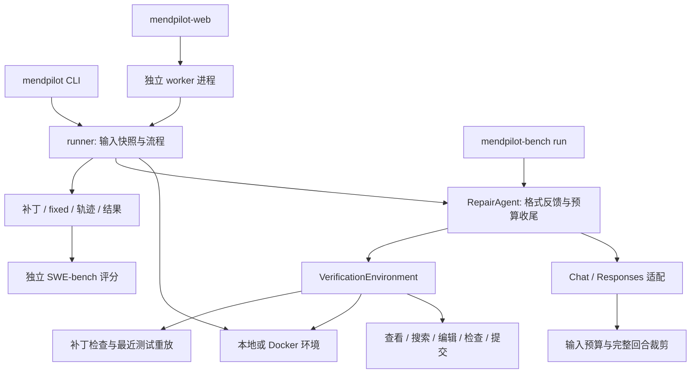

# 项目结构与修复流程

`src/mendpilot/` 中，`cli.py` 负责参数和运行时凭据，`runner.py` 负责通用修复流程，`source.py` 负责读取、过滤与输入快照。CLI 与网页都调用 runner，不维护两套 Agent。

`core/agent.py` 基于已安装 mini-swe-agent 的 DefaultAgent 增加格式反馈与预算收尾；`context.py` 保留初始任务和近期完整工具回合，必要时缩短工具输出，仅裁剪 API 视图，完整轨迹保留；`budget.py` 限制工具期限；`verification.py` 初始化工具、反馈重复命令、拦截提交并重放最近成功的独立测试；`prompts.py` 直接保存当前提示词。

`models/` 分别提供配置工厂、Chat 和 Responses 传输、错误分类、有限重试及凭据过滤。Responses 保留 reasoning/调用 ID 与对应输出；凭据只进入运行时客户端，不进入可序列化模型配置。`environments/` 封装当前环境执行和 Docker 复制/导出。`tools/repair_tools.py` 为 Python 3.6+ 可运行的独立 stdlib 工具，可复制到任务容器。

修复检查采用可选注册和自动重放：Agent 可直接运行复现/回归测试，无需凑齐固定检查数量才能提交。提交时检查非空补丁和空白错误，重放最近记录的成功测试；失败反馈回 Agent。可选 `check/verify` 工具仍支持显式注册和干净检出验证。用户通过 CLI 指定的测试也会在提交时重放。没有可见测试时，提交状态不代表正确性证明。

`web/` 仅负责单文件上传、任务进程和结果访问，独立 worker 调 runner。`evaluation/` 单独准备任务、生成补丁和调用官方评分器，仅运行 MendPilot。生成阶段只读取公开问题字段，隐藏补丁和测试由独立 scorer 读取。

根目录的 `benchmarks/` 保存固定划分及协议，`results/` 仅保存两份公开结果表；`docs/`、`examples/`、`docker/`、`tests/` 分别存放文档、使用示例、可选环境与程序测试。用户运行输出不随源码分发，程序和测试不依赖 `results/` 中的展示表。
